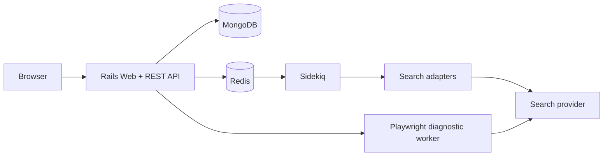
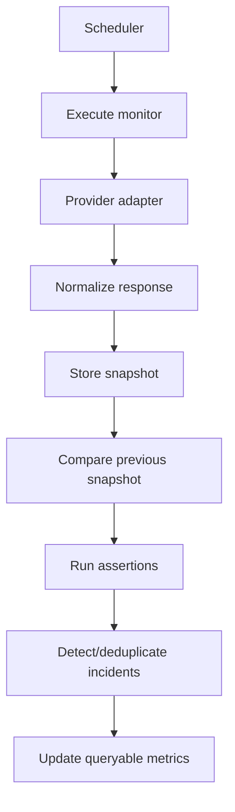

# QueryPulse

**Monitor search APIs, detect structural and relevance changes, and investigate reliability regressions with Ruby on Rails.**

QueryPulse is an independent developer tool for continuously observing structured search responses. It records reproducible snapshots, normalizes provider data, detects schema and ranking changes, evaluates explicit quality assertions, tracks latency, and groups recurring failures into actionable incidents.

## The problem

Search responses are dynamic even when application code is unchanged. Rankings move, localization changes results, optional fields disappear, provider schemas evolve, and transient failures are hard to reproduce. Conventional uptime checks show that an endpoint answered; QueryPulse preserves enough structured evidence to explain *how* the answer changed.

## Features

- Scheduled and manual query execution through provider adapters
- Production SerpApi Google adapter and deterministic offline fake adapter
- MongoDB snapshots retaining normalized and provider-specific documents
- Deterministic schema/content fingerprints and recursive JSON comparison
- Canonical-URL rank movement with configurable noise thresholds
- Explicit result, domain, content, field, and latency assertions
- Explainable 0–100 relevance score without an LLM
- Deduplicated incident lifecycle with automatic healthy-run resolution
- Actual 1h, 24h, and 7d reliability metrics including p50/p95/p99
- Dense dashboard, monitor detail, run inspector, incident views, and playground
- Fixture-based resilient HTML parser laboratory
- Isolated TypeScript/Playwright browser diagnostics with DNS-aware SSRF controls
- Versioned REST API and OpenAPI contract

## Quick start

Requirements: Docker Desktop with Compose.

```bash
git clone <repository-url> query-pulse
cd query-pulse
cp .env.example .env
docker compose up -d mongodb redis
docker compose build web sidekiq
docker compose run --rm web bin/setup
docker compose run --rm web bin/demo
docker compose up web sidekiq browser-worker
```

Open `http://localhost:3000/dashboard`. The application defaults to the fake provider, so no external account is required.

Common commands:

```bash
bin/setup                         # gems, assets, MongoDB indexes
bin/dev                           # Rails, CSS watcher, Sidekiq
bin/test                          # RSpec
bin/lint                          # RuboCop, ESLint, Prettier
bin/demo                          # deterministic persisted demo scenario
bin/rails benchmark:comparison    # live comparison benchmark
```

On systems without native Ruby, run the commands through `docker compose run --rm web`.

## Demo workflow

`bin/demo` creates eight monitors and 240 historical runs. The “GitHub Ruby Results” monitor begins with healthy `github.com` results and later receives a synthetic degraded snapshot containing unexpected domains, a removed field, a type change, ranking movement, and slower latency. “Rare Query Watch” ends with an empty result set. All dashboard figures are computed from those persisted records; the scenario is explicitly synthetic and does not claim a provider defect.

1. Open the dashboard and inspect active incidents.
2. Open **GitHub Ruby Results** and select its latest execution.
3. Use the inspector’s Changes, Assertions, and Diagnostics tabs.
4. Acknowledge or resolve an incident.
5. Run an offline request in the Playground and save it as a monitor.

## Architecture

QueryPulse is a modular Rails monolith. Browser automation is isolated because Chromium has a materially different dependency and threat profile.





The service boundaries under `app/services` isolate search transport, normalization, comparison, assertions, incidents, metrics, parsing, and observability without introducing network boundaries.

## Data model and MongoDB choice

`QueryPulse::Monitor` owns `SearchRun`, `Snapshot`, and `Incident` documents. MongoDB fits the workload because provider payloads are nested, sparse, and versioned; snapshots are written once and read as complete diagnostic documents. Keeping normalized JSON intact avoids brittle table proliferation while typed top-level fields and compound indexes support bounded operational queries.

Indexes follow real access paths: enabled monitors by due time, runs by monitor/start time, snapshots by monitor/capture time and unique run, and incidents by monitor/status and type/status. Raw responses can become large; production retention should expire or archive old payloads while retaining hashes and summaries.

## Change detection and schema fingerprinting

`Comparison::SchemaExtractor` maps each primitive to its JSON type, recursively sorts object keys, and merges array item shapes. Canonical JSON is SHA-256 hashed. Equal schema hashes cheaply rule out structural drift; differing hashes trigger the recursive comparator.

`Comparison::ResultComparator` walks object key unions and paired arrays to emit `FIELD_ADDED`, `FIELD_REMOVED`, `TYPE_CHANGED`, `VALUE_CHANGED`, and `ARRAY_LENGTH_CHANGED`. Organic results are matched by canonical URL (query/fragment removed) with domain + normalized title as fallback. `RESULT_ORDER_CHANGED` appears only when absolute position movement meets the configured threshold. Volatile request identifiers and timestamps are ignored by configurable JSON paths.

Complexity is O(n log n) in the typical case because canonical object keys are sorted; recursive comparison itself is O(n), and organic-result identity maps are O(r). Memory is O(n) for schemas, changes, and ranking maps. Run the included benchmark for measured results on local hardware rather than relying on fabricated numbers.

## Assertions and relevance

Supported assertions are `minimum_results`, `maximum_results`, `required_domains`, `forbidden_domains`, `title_contains`, `snippet_contains`, `maximum_response_time_ms`, and `required_fields`. Every evaluation records expected, actual, pass/fail, and details.

The relevance score is deterministic:

- 40 points: query-token coverage across titles/snippets
- 25 points: share of returned domains matching configured required domains (full points when none configured)
- 20 points: configured title expectation coverage
- 10 points: configured snippet expectation coverage
- 5 points: overall assertion pass ratio

Scores are clamped to 0–100. Components are stored in run diagnostics so an engineer can explain the number.

## Incidents, retries, and performance

Incident fingerprints combine monitor, incident type, and JSON path. An active match increments `occurrence_count` and `last_seen_at`; it does not create another row. Three consecutive healthy executions automatically resolve active issues. Authentication and invalid responses are not retried. Faraday retries only timeouts, connection failures, rate limits, and selected 5xx responses with bounded exponential backoff; job idempotency keys prevent duplicate scheduled runs.

Metrics query real runs within 1h/24h/7d windows. Latency regression compares the most recent p95 against a prior baseline only when both sets contain at least ten samples. The default alert threshold is a 50% increase.

## Provider integrations

Set `SEARCH_PROVIDER=fake` for deterministic offline behavior. With `SEARCH_PROVIDER=serpapi` and `SEARCH_API_KEY`, Google requests use SerpApi. HTTP details remain inside `Search::GoogleAdapter`; new providers implement the `Search::BaseAdapter#execute` contract and return `Search::Result`.

## Security

- Credentials live in environment variables, are parameter-filtered, and never appear in structured logs.
- API and execution endpoints have IP rate limits and bounded request bodies.
- Provider inputs are validated and adapters use fixed upstream endpoints.
- Browser diagnostics use an exact hostname allowlist, resolve every request destination, and block loopback, RFC1918, carrier-grade NAT, link-local, unique-local IPv6, multicast, and metadata destinations. Redirects and subresources receive the same check.
- Challenge pages are classified and recorded; QueryPulse performs no CAPTCHA solving, fingerprint spoofing, or access-control bypass.
- Rails escaping, CSP support, modern secure headers, short network timeouts, and bounded error messages reduce common exposure.

See [browser threat model](docs/architecture/browser-threat-model.md) for residual risks.

## API

Human-oriented docs are available at `/docs`; the machine-readable contract is [public/openapi.yaml](public/openapi.yaml). Errors use a consistent envelope:

```json
{ "error": { "code": "INVALID_MONITOR", "message": "Monitor validation failed", "details": {} } }
```

## Testing and CI

RSpec covers schema extraction/hashing, recursive diffs, ignored paths, ranking movement, assertions, relevance, incident deduplication/resolution, latency metrics, adapters, execution persistence, parser fixtures, CRUD, manual execution, run diffs, incidents, pagination, metrics, and health. WebMock prevents provider calls. Playwright tests the browser worker’s network policy offline. GitHub Actions runs RSpec with MongoDB/Redis services, RuboCop, Brakeman, TypeScript build, ESLint/Prettier, Playwright tests, and uploads Playwright reports on failure.

## Operations and scale

At roughly 10 monitors, one default queue and direct aggregation are sufficient. Near 10,000 monitors, partition queues by provider/priority, enforce quota-aware backpressure, introduce Redis locks around scheduler claims, pre-aggregate metrics, and apply snapshot TTL/archival. At larger scale, shard MongoDB by monitor, compress/cold-store raw payloads, separately retain normalized summaries, isolate provider concurrency pools, and prioritize incident-producing jobs. These changes should follow measured queue lag, document growth, and provider quota pressure—not precede them.

## Engineering decisions

ADRs in `docs/adr` explain document storage, the modular monolith, normalized results, fixture parsers, Sidekiq execution, and browser isolation. Additional implementation discussion lives in [engineering notes](docs/engineering-notes.md), the [case study](docs/case-studies/search-quality-regression.md), and the [technical article](docs/blog/search-api-regression-detection.md).

## Known limitations and future work

- No user authentication or team/role model; deploy behind trusted access until added.
- The first real provider adapter targets SerpApi Google results; Bing remains a declared extension point.
- Metrics are computed on demand; high-volume deployments need rollups.
- Snapshots have no built-in TTL/archive policy yet.
- Browser diagnostics are an isolated HTTP worker but are not yet triggered from the Rails UI.
- Rails UI workflows have request coverage; browser-level end-to-end coverage currently focuses on the worker security boundary.
- Distributed scheduler locking is not needed for the default single scheduler and should be added before horizontal scheduler scaling.

Recommended next steps are authentication/API tokens, retention policies, provider quota budgets, browser-worker job integration, notification channels, and pre-aggregated metric buckets.

## Environment variables

| Variable | Required | Purpose |
|---|---:|---|
| `MONGODB_URI` | yes | MongoDB connection URI |
| `REDIS_URL` | yes | Sidekiq, scheduler, and health Redis URI |
| `SEARCH_PROVIDER` | no | `fake` (default) or `serpapi` |
| `SEARCH_API_KEY` | for SerpApi | Provider credential |
| `BROWSER_WORKER_URL` | no | Isolated diagnostics endpoint |
| `SIDEKIQ_CONCURRENCY` | no | Worker concurrency, default 5 |

## License

Add the license appropriate for your deployment before redistribution.
