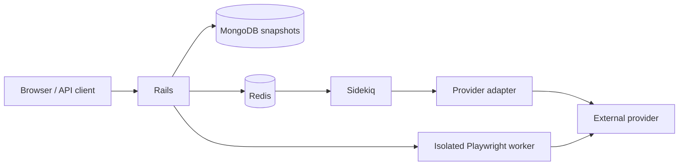
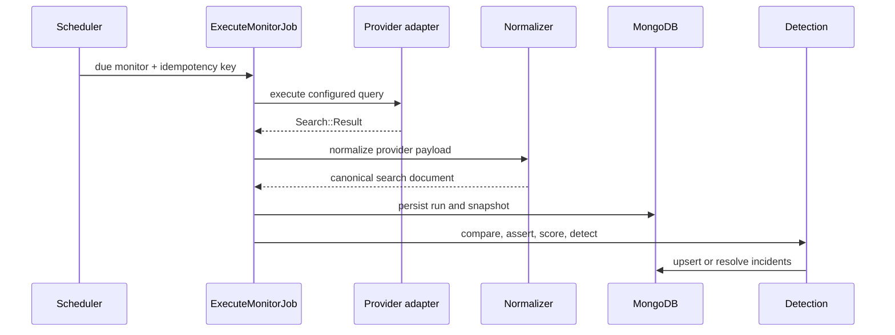

# System architecture and execution lifecycle

The execution service deliberately owns one vertical transaction-like workflow. Persisted statuses and idempotency make partial execution observable without requiring a distributed workflow engine.
